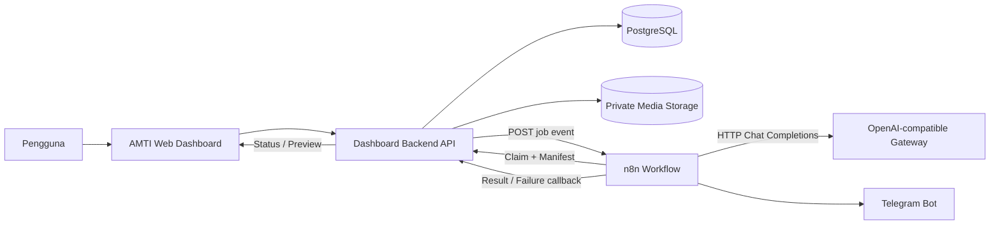
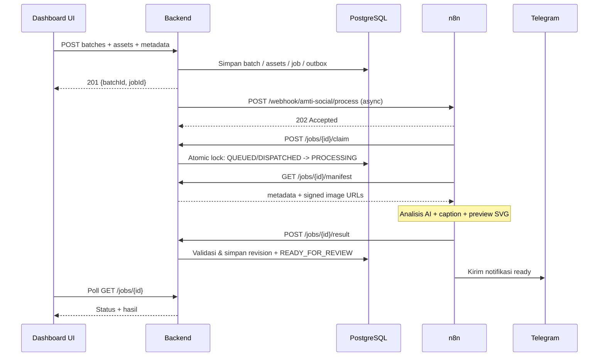

> **Arsip referensi awal.** Dokumen ini dipertahankan untuk riwayat, bukan spesifikasi aktif. Role, route, storage, dan menu dapat berbeda dari aplikasi sekarang. Lihat [implementasi saat ini](IMPLEMENTATION.md) dan [database aktif](../DATABASE_GUIDE.md).

# PRODUCT REQUIREMENTS DOCUMENT (PRD)

# AMTI Social Media Agent Dashboard V1.1 (camelCase)

**Dokumen untuk:** AI Coding Agent / Full Stack Developer\
**Perusahaan:** PT Asset Monitoring Teknologi Indonesia (AMTI)\
**Versi:** 1.1, 16 Oktober 2026\
**Status:** Draft siap implementasi tahap dashboard\
**Bahasa UI:** Bahasa Indonesia\
**Zona waktu UI:** Asia/Jakarta (WIB)\
**Tagline:** Data Today, Safer Tomorrow\
**Integrasi utama:** n8n workflow `AMTI n8n OpenAI Workflow V0.2`\
**AI endpoint (berjalan di n8n, bukan dashboard):** OpenAI-compatible Chat Completions; model `cx/gpt-5.6-luna`.

> **Instruksi terpenting kepada AI Coding Agent:** Bangun dashboard dan backend yang menjadi *system of record*. **Jangan implementasikan panggilan AI dari dashboard/backend.** Semua panggilan AI vision dan caption dijalankan oleh n8n melalui workflow yang sudah tersedia. Dashboard hanya menerima upload, menyimpan aset dan metadata, membuat job, men-trigger webhook n8n, menerima callback, dan menyediakan editor/review.

---


### Konvensi penamaan wajib: camelCase

Semua identifier baru milik aplikasi, termasuk **JSON request/response, variabel JavaScript/Python, fungsi aplikasi, nama field model/ORM, kolom dan tabel database, serta parameter path REST**, menggunakan `lowerCamelCase`: `jobId`, `batchId`, `assetId`, `projectName`, `requestedOutputs`, `createdAt`, `contentRevisionId`, `socialJobs`.

Pengecualian disengaja: **nama class/type** memakai `PascalCase` (`SocialJob`, `UploadContentPage`), **konstanta dan enum status** tetap `UPPER_SNAKE_CASE` (`READY_FOR_REVIEW`), **environment variable** tetap `UPPER_SNAKE_CASE` (`N8N_WEBHOOK_URL`), header HTTP standar tetap sesuai ejaan protokol, dan nama field eksternal milik provider mengikuti spesifikasi provider. Nama path URL statis tetap kebab-case bila telah menjadi route publik. Jika PostgreSQL memakai tabel/kolom camelCase, definisikan quoted identifiers secara eksplisit dalam migration dan ORM karena identifier PostgreSQL tak-quoted akan dilipat menjadi lowercase.

**Kontrak integrasi:** Workflow `AMTI n8n OpenAI Workflow V0.2` saat ini masih memakai key `snake_case`. PRD ini menetapkan kontrak **dashboard kanonis camelCase**. Sebelum produksi, wajib lakukan salah satu secara eksplisit: (A) upgrade node n8n ke `camelCase` di seluruh request dan callback, **diutamakan**, atau (B) gunakan satu adapter serialisasi di backend untuk menerima/mengirim `snake_case` khusus koneksi legacy V0.2. **Jangan mengirim payload camelCase mentah ke V0.2 tanpa adapter karena workflow bisa gagal.**

## 1. Konteks dan ruang lingkup

### 1.1 Masalah

Dokumentasi proyek AMTI (foto pemasangan sensor, monitoring, instrumentasi, inspeksi, dan aktivitas lapangan) belum memiliki satu alur terpusat untuk upload, kurasi AI, rendering template Feed/Story, caption, dan review. Diperlukan dashboard yang dapat berkomunikasi dengan n8n melalui API yang jelas, aman, dan dapat diaudit.

### 1.2 Tujuan V1

1. Pengguna login dan mengunggah foto proyek serta metadata wajib.
2. Backend menyimpan foto original secara privat dan membentuk job pemrosesan.
3. Backend men-trigger webhook n8n dengan ID job dan batch, tanpa mengirim file besar ke webhook.
4. n8n melakukan analisis foto, pembuatan caption, dan pembuatan preview SVG.
5. n8n memanggil REST API backend untuk mengembalikan hasil atau kegagalan.
6. Dashboard menampilkan status, ranking, preview, caption, dan memungkinkan koreksi manual.
7. Telegram menerima notifikasi draft siap atau gagal **dari n8n**.
8. Setiap proses, retry, dan perubahan dicatat untuk audit.

### 1.3 Batasan penting V1

- **Termasuk:** Login dan RBAC, Overview, Upload Content, AI Jobs, AI Studio, Content Review, Media Library, Logs, Settings, webhook n8n, callback API, notifikasi status UI.
- **Tidak termasuk:** Posting Instagram, penjadwalan publish, Meta OAuth, approval interaktif melalui Telegram, analitik Instagram, video/Reels, manipulasi foto generatif.
- **Telegram V1:** Notifikasi saja (`READY_FOR_REVIEW`, `FAILED`). Approval melalui Telegram dapat ditambahkan pada fase berikutnya.
- **Render V0.2:** n8n mengembalikan **SVG yang merujuk ke URL foto eksternal**. Itu preview teknis, **bukan PNG/JPEG final**, bukan template AMTI final dan tidak boleh ditandai `PUBLISH_READY`. Render final memerlukan pengembangan lanjutan di dalam n8n.
- **Vision:** Dukungan gambar pada gateway model `cx/gpt-5.6-luna` belum terkonfirmasi. Jika tidak didukung, tampilkan error yang dapat ditindaklanjuti, jangan membuat ranking palsu.

### 1.4 Pengguna

| Peran | Upload | Lihat batch sendiri | Lihat seluruh konten | Edit AI Studio | Review/Approve internal | Settings/Logs |
|---|---|---|---|---|---|---|
| `ADMIN` | Ya | Ya | Ya | Ya | Ya | Ya |
| `MARKETING` | Ya | Ya | Ya | Ya | Ya | Log terbatas |
| `REVIEWER` | Opsional | Ya* | Ya | Ya | Ya | Tidak |
| `UPLOADER` | Ya | Ya | Tidak | Tidak | Tidak | Tidak |

\* Reviewer melihat batch yang diizinkan oleh organisasi. Akses ditegakkan di backend; visibilitas UI bukan mekanisme keamanan.

---

## 2. Prinsip arsitektur



**Ketentuan implementasi:**

- AI processing dan prompt dikelola di n8n, bukan di backend.
- Database backend adalah **single source of truth** untuk users, batches, assets, job state, content drafts, revisions, dan logs.
- n8n tidak menjadi tempat penyimpanan file permanen.
- Backend menyimpan semua waktu dalam UTC; UI menampilkan WIB.
- Gunakan HTTPS untuk dashboard, API, dan signed media URLs. Gateway AI yang tersedia saat ini ber-HTTP dan perlu diamankan **di sisi n8n/network**, bukan diekspos ke browser.
- Endpoint internal n8n dan API key tidak boleh muncul dalam HTML, JavaScript browser, source frontend, atau respons publik.
- File original bersifat immutable; hasil preview/render adalah objek atau versi tersendiri.
- Pengiriman event webhook **tidak dilakukan dalam transaksi DB**. Simpan job + outbox, lalu worker/dispatcher mengirim event. Jika trigger n8n gagal, job tetap tercatat dan dapat diulang.

### 2.1 Stack target

**Usulan implementasi:**

- Backend: **Flask + SQLAlchemy + Alembic** (menyesuaikan ekosistem aplikasi internal AMTI), atau gunakan stack proyek eksisting bila repository yang diberikan berbeda.
- Dashboard: **Jinja2 + Bootstrap 5 / vanilla JavaScript** untuk integrasi Flask cepat, atau **framework frontend eksisting** tanpa membuat aplikasi kedua yang tidak perlu.
- Database: **PostgreSQL**.
- Upload/storage: Private local volume sebagai MVP, dengan abstraksi `StorageService` yang bisa berpindah ke S3-compatible.
- Queue: DB-backed outbox/dispatcher; tidak wajib Redis/Celery untuk MVP.
- Reverse proxy: Nginx HTTPS.
- AI: hanya via n8n, memanggil gateway Chat Completions.
- n8n: workflow yang sudah ada, akses melalui HTTPS/private network.

**AI Coding Agent wajib terlebih dahulu menginspeksi repository.** Jika proyek sudah memiliki pola arsitektur, autentikasi, component library, migrasi dan storage sendiri, prioritaskan reuse. Jangan melakukan rewrite total atau memodifikasi modul existing yang tidak relevan.

---

## 3. Navigasi dan pengalaman pengguna

**Sidebar:** Overview, Upload Content, AI Jobs, AI Studio, Content Review, Media Library, Activity Logs (role terbatas), Settings (ADMIN).

**Global:** Topbar pencarian sederhana (opsional P1), user menu, notifikasi status lokal, logo AMTI resmi dari aset yang disediakan, tema bersih navy/cyan, mobile-responsive, semua label berbahasa Indonesia.

### 3.1 Halaman Overview `/social/overview`

- KPI cards: `Total Batch`, `Total Foto`, `AI Sedang Diproses`, `Siap Review`, `Gagal`, `Draft Disetujui Internal`.
- Daftar job terbaru: tanggal WIB, proyek, uploader, status, output Feed/Story, aksi Detail.
- Panel job gagal: error ramah pengguna dan tombol Lihat/Reprocess sesuai role.
- Tidak boleh menggunakan angka dummy di production setelah API terhubung.
- Filter periode 7/30/90 hari; nilai default 30 hari.

**Acceptance:** kartu bersumber dari API terfilter hak akses, hasil berubah setelah callback tanpa full reload (polling 5 detik pada detail job, interval 15-30 detik pada overview).

### 3.2 Upload Content `/social/upload`

**Field form:**

| Field | Tipe | Aturan |
|---|---|---|
| Nama proyek | Text/select | Wajib, panjang 3-150 karakter |
| Aktivitas | Text | Wajib, panjang 3-200 karakter |
| Lokasi umum | Text | Wajib, hindari koordinat sensitif |
| Tanggal dokumentasi | Date | Wajib; tidak boleh melebihi hari ini kecuali admin override |
| Deskripsi teknis | Textarea | Opsional, maksimal 2000 karakter |
| Nama klien yang boleh disebut | Text | Opsional; cek izin |
| Izin publikasi | Checkbox | Wajib `true` sebelum AI memproses; rekam siapa dan kapan |
| Output | Checkbox | `Feed`, `Story`, minimal satu |
| Foto | Multi-upload | JPG, PNG, WEBP, hingga 30 file/batch, maksimal 15 MB/file (configurable) |

- Drag-and-drop, pilih file, pratinjau thumbnail, ukuran file, hapus item sebelum submit.
- Validasi signature/MIME asli di server, ukuran, ekstensi, dimensi, jumlah, malware scanning bila tersedia.
- EXIF GPS dihapus dari versi yang digunakan untuk media publik/AI bila diwajibkan kebijakan; original privat tetap utuh.
- Konfirmasi status izin secara eksplisit; jangan menebak izin dari gambar.
- Setelah validasi dan upload selesai: buat `batch`, `assets`, `job`, dan `outbox event` dalam satu transaksi.
- UI pindah ke halaman job dan menampilkan status `QUEUED`.
- Backend mengirim webhook melalui dispatcher, **bukan browser**.
- Gagal mengirim n8n tidak menghilangkan berkas dan tidak mewajibkan upload ulang.

**Acceptance:** 1, 5, 20, dan 30 foto valid berhasil; format tidak valid ditolak per file; tidak ada duplikasi akibat double click (client `Idempotency-Key`).

### 3.3 AI Jobs `/social/jobs`

- Tabel: Job ID, batch, proyek, uploader, dibuat pada, mulai, selesai, status, eksekusi n8n, output, durasi, aksi.
- Filter: status, proyek, uploader (bila berhak), periode, output.
- Status visual + teks dan alasan error yang disanitasi.
- Detail job: garis waktu `CREATED -> QUEUED -> DISPATCHED -> PROCESSING -> READY_FOR_REVIEW / FAILED`, dengan tahap granular bila tersedia.
- Pada status `PROCESSING`, tampilkan animasi dan **status aktual**, bukan persentase rekayasa.
- Tombol `Proses Ulang` untuk `FAILED`, dengan idempotency dan audit; buat attempt baru, gunakan aset existing.
- Tombol `Lihat Hasil` aktif hanya ketika `READY_FOR_REVIEW` atau status review lanjut.

**Acceptance:** callback hasil n8n mengubah status; refresh/browser restart tidak menghilangkan progres; hasil duplikat diproses aman.

### 3.4 AI Studio `/social/studio/{jobId}`

Tata letak desktop tiga kolom:

1. **Foto terpilih:** gallery thumbnail, skor AI 0-100, alasan/label, penanda duplikat bila tersedia, peringkat, ganti foto utama; semua ranking hanya berasal dari output AI nyata.
2. **Preview visual:** switch `Feed 4:5 / Story 9:16`, ukuran preview proporsional, zoom sederhana, peringatan `SVG preview, belum siap Instagram`, fallback gambar original apabila render gagal.
3. **Editor konten:** judul, caption, hashtag, pilihan aset utama, lokasi, aktivitas, tombol Simpan Revisi / Kembalikan ke Output AI.

Aturan penting:

- `selectedAssetIds` n8n bisa berisi maksimal lima ID; **render V0.2 hanya menggunakan gambar terpilih pertama**. UI harus menjelaskan perbedaannya agar pengguna tidak mengira seluruh foto otomatis dirender.
- Editor dapat mengganti aset utama; jika SVG dari n8n masih menggambarkan aset sebelumnya, beri label preview `OUTDATED` dan jangan tampilkan sebagai preview revisi final. Untuk rendering ulang, butuh workflow n8n lanjutan atau tampilkan placeholder sampai tersedia. **Jangan membuat preview palsu yang berbeda dari hasil terbit.**
- Hashtag di-editor sebagai daftar kata, jangan sisipkan otomatis ke caption tanpa keputusan editor.
- Autosave opsional P1; V1 gunakan `Simpan Revisi` eksplisit.
- Setiap simpan membuat `contentRevision` baru. Simpan *AI raw suggestion* secara terpisah dari *human edited version*.
- Jangan izinkan status `READY_FOR_REVIEW` bila output AI sebenarnya gagal/parsial dan tidak tervalidasi.
- Render SVG tidak boleh disisipkan mentah ke DOM. Sanitasi di server, larang script dan external resource tidak diizinkan, tampilkan melalui asset sandbox/isolated origin atau strategi aman lain. Render dengan sumber foto bertanda tangan yang masa berlakunya terbatas. Kontrol CORS dan CSP ketat.

**Acceptance:** bisa melihat ranking, berpindah Feed/Story, mengedit caption/judul/hashtag, menyimpan revisi, memuat ulang dan mempertahankan perubahan.

### 3.5 Content Review `/social/review`

- Daftar draft status `READY_FOR_REVIEW`, `IN_REVIEW`, `REVISION_REQUESTED`, `APPROVED_INTERNAL`, `REJECTED`.
- Reviewer dapat membuka versi draft, mengisi catatan, `Setujui Internal`, `Minta Revisi`, atau `Tolak`.
- Persetujuan ini **hanya status internal dashboard**, bukan approval Telegram dan bukan perintah Instagram publish.
- Setiap persetujuan melekat pada `contentRevisionId` dan checksum konten.
- Jika judul, foto terpilih, caption, hashtag, atau preview berubah, approval sebelumnya otomatis tidak berlaku.
- Uploader tidak memiliki tombol approve/reject.
- `APPROVED_INTERNAL` bukan `PUBLISH_READY` selama render final PNG/JPEG dan pemeriksaan provider belum diselesaikan.

**Acceptance:** audit siapa, kapan, keputusan dan catatan; approval versi usang ditolak HTTP 409.

### 3.6 Media Library `/social/media`

- Tampilkan original dan hasil preview sebagai entitas terpisah.
- Filter proyek, tanggal, tipe file, batch.
- Preview thumbnail, informasi file, checksum, tanggal upload.
- Download original hanya melalui endpoint otorisasi, bukan URL storage permanen.
- Penghapusan soft-delete saja dengan role ADMIN dan audit. Jangan otomatis menghapus original yang masih direferensikan draft/job.

### 3.7 Activity Logs `/social/logs`

- Catatan login penting, batch created, upload completed, job dispatched, claimed, callback ready/failed, retry, edit, review.
- Search berdasarkan jobId, batchId, user, event type.
- Log tidak boleh memuat token, signed URL penuh, teks kredensial, atau raw AI request yang sensitif.
- Ringkasan error aman untuk Marketing; stack trace detail hanya admin/server log.

### 3.8 Settings `/social/settings`

- Integrasi n8n: status health, webhook base URL **masking**, timeout, enable/disable dispatch, test koneksi aman.
- Telegram: indikator configured/not configured, `chatId` ditampilkan mask, test message melalui n8n bila workflow test tersedia (tidak mengirim token ke frontend).
- Brand kit: daftar template Feed/Story, logo resmi dan versi; *gunakan template yang benar-benar tersedia*, jangan buat logo palsu.
- Upload policy: batas file, batas batch, format, retensi (P1).
- User/Role: ADMIN saja (reuse user management existing bila ada).
- Kunci API AI hanya berada di n8n. **Jangan buat field API key OpenAI di dashboard.**

---

## 4. Workflow end-to-end yang harus diikuti



### 4.1 Kontrak kompatibilitas dengan n8n V0.2

Payload kanonis `camelCase` yang harus dikirim setelah workflow n8n di-upgrade atau melalui adapter ke V0.2:

```json
{
  "eventId": "evt_01JABC123",
  "jobId": "job_01JABC123",
  "batchId": "batch_01JABC123",
  "requestedBy": "user_01JABC123",
  "requestedOutputs": ["feed", "story"]
}
```

`eventId`, `jobId`, `batchId` wajib alfanumerik/underscore/hyphen (maksimal 128 karakter). `requestedOutputs` hanya `feed`/`story`. ID contoh di atas bersifat ilustratif.

**Catatan:** Trigger webhook merespons `202` sebelum AI selesai. Jangan menggunakan respons webhook sebagai hasil AI.

### 4.1.1 Pemetaan payload workflow n8n V0.2 ke camelCase

| Field n8n V0.2 (`snake_case`) | Field dashboard (`camelCase`) |
|---|---|
| `event_id` | `eventId` |
| `job_id` | `jobId` |
| `batch_id` | `batchId` |
| `requested_by` | `requestedBy` |
| `requested_outputs` | `requestedOutputs` |
| `project_name` | `projectName` |
| `review_url` | `reviewUrl` |
| `asset_id` | `assetId` |
| `ai_image_url` | `aiImageUrl` |
| `render_image_url` | `renderImageUrl` |
| `execution_id` | `executionId` |
| `result_version` | `resultVersion` |
| `selected_asset_ids` | `selectedAssetIds` |
| `safe_message` | `safeMessage` |
| `error_code` | `errorCode` |

Adapter harus bidirectional, diuji dengan fixture request/response n8n V0.2 yang nyata dan tidak mengubah nama field pihak ketiga seperti `messages`, `model`, atau `Authorization`. Penggunaan adapter bersifat transisi; sumber kontrak internal tetap camelCase.

### 4.2 API internal untuk n8n (harus compatible)

| Method | Path | Otentikasi | Fungsi |
|---|---|---|---|
| POST | `/api/social/jobs/{jobId}/claim` | Service token | Atomic claim job |
| GET | `/api/social/jobs/{jobId}/manifest` | Service token | Metadata dan URL gambar HTTPS singkat |
| POST | `/api/social/jobs/{jobId}/result` | Service token | Simpan output AI dan preview |
| POST | `/api/social/jobs/{jobId}/failure` | Service token | Catat gagal |

Service token digunakan **server to server**. Validasi `Authorization: Bearer <token>` dengan rotasi/konfigurasi aman, log tanpa token. Opsional tambah HMAC + timestamp bila n8n gateway mendukung, tetapi jangan diam-diam mengubah skema n8n V0.2 tanpa memperbarui workflow.

#### POST Claim

Request: tanpa body khusus; header service token + `X-Request-ID`.

Respons berhasil (HTTP 200):

```json
{ "claimed": true }
```

Job sudah di-claim / tidak eligible (HTTP 200):

```json
{ "claimed": false }
```

Gunakan conditional atomic update dalam transaksi DB. Jangan izinkan job ganda, termasuk saat retry paralel. Simpan waktu `startedAt` dan `executionClaimId` bila dapat diperoleh.

#### GET Manifest

Contoh respons:

```json
{
  "jobId": "job_01JABC123",
  "projectName": "Monitoring Jembatan",
  "activity": "Pemasangan accelerometer",
  "location": "Indonesia",
  "description": "Dokumentasi pemasangan sensor SHMS",
  "reviewUrl": "https://dashboard.amti.example/social/studio/job_01JABC123",
  "assets": [
    {
      "assetId": "asset_01JABC123",
      "aiImageUrl": "https://media.amti.example/signed/asset_01JABC123",
      "renderImageUrl": "https://media.amti.example/signed/asset_01JABC123",
      "description": "Foto instalasi perangkat"
    }
  ]
}
```

- `aiImageUrl` dan `renderImageUrl` harus HTTPS dan dapat dijangkau gateway AI / n8n selama proses. Kebijakan akses URL harus mempertimbangkan bahwa gateway AI bisa mengambil URL dari luar VPS.
- Maksimum 30 assets per batch, tetapi **workflow V0.2 mengevaluasi paling banyak 20 foto pertama**. Untuk V1 kompatibel, **batasi satu job AI menjadi 20 foto**; bila 21-30 file diunggah, pecah menjadi beberapa job atau tampilkan informasi keterbatasan sampai workflow batch diperbarui. Jangan diam-diam mengabaikan sisa foto.
- URLs harus berumur cukup untuk eksekusi + review preview, atau disimpan ulang sebagai preview aman; jangan menganggap SVG yang merujuk URL pendek dapat dilihat selamanya.
- `reviewUrl` harus pakai domain dashboard aktual, bukan `.example`.
- Pastikan signed URL tidak loggable secara penuh dan hanya mengakses aset spesifik.

#### POST Result

Payload hasil kanonis `camelCase` yang dinormalisasi oleh workflow baru atau backend adapter dari n8n V0.2:

```json
{
  "jobId": "job_01JABC123",
  "executionId": "42",
  "resultVersion": 1,
  "status": "READY_FOR_REVIEW",
  "selectedAssetIds": ["asset_01JABC123"],
  "rankings": [
    { "assetId": "asset_01JABC123", "score": 93, "reason": "Foto jelas" }
  ],
  "caption": "Dokumentasi pekerjaan monitoring struktur.",
  "hashtags": ["#AMTI", "#SHMS"],
  "title": "Monitoring Struktur",
  "renders": [
    {
      "placement": "feed",
      "format": "svg",
      "width": 1080,
      "height": 1350,
      "svg": "<svg xmlns=\"http://www.w3.org/2000/svg\">...</svg>",
      "assetId": "asset_01JABC123",
      "warning": "SVG references remote image"
    }
  ],
  "projectName": "Monitoring Jembatan",
  "reviewUrl": "https://dashboard.amti.example/social/studio/job_01JABC123"
}
```

*Catatan:* Elemen `rankings[]` bisa memuat atribut tambahan dari AI; validasi properti inti saja dan simpan informasi ekstra terstruktur dengan batas ukuran, bukan menganggap contoh sebagai schema pasti.

**Backend harus:**

- Verifikasi service token dan job terkait.
- Validasi `status == READY_FOR_REVIEW`, ID asset tergolong batch, setiap placement diizinkan, tipe mime/format, panjang string, skor 0-100.
- Terapkan batas request size, length title/caption, jumlah hashtag dan SVG; sanitasi SVG.
- Idempotency unique `(jobId, executionId, resultVersion)` atau signature payload, hindari duplicate revision.
- Terima callback hanya dari attempt/job valid dan aktif; callback attempt lama ditolak atau dicatat sebagai stale, tanpa overwrite draft baru.
- Simpan hasil AI asli immutable dan buat `contentRevision` pertama.
- Perbarui status job menjadi `READY_FOR_REVIEW` secara atomik.
- Kembalikan respons `200 {"accepted":true,"jobId":"..."}`; duplikasi sah dapat mengembalikan `200 {"accepted":true,"duplicate":true}`.
- Jika callback gagal validasi, gunakan status HTTP tepat (400, 401, 403, 409, 413, 422, 500) dan jangan menyatakan sukses.

#### POST Failure

Contoh:

```json
{
  "executionId": "42",
  "stage": "WORKFLOW",
  "errorCode": "WORKFLOW_ERROR",
  "safeMessage": "AI image input unsupported",
  "retryable": false
}
```

- Simpan error ringkas dan stage, tanpa API key, foto private URL, atau stack trace.
- Tandai `FAILED` hanya bila claim/attempt masih relevan dan belum ada hasil final.
- Duplicate failure callback tidak menghasilkan audit spam.
- Retry dibuat pengguna/admin sebagai attempt/job yang jelas, bukan memodifikasi job selesai diam-diam.

### 4.3 API untuk dashboard (frontend)

| Method | Endpoint | Fungsi | Role |
|---|---|---|---|
| GET | `/api/social/overview` | KPI & recent jobs | Authenticated |
| POST | `/api/social/batches` | Buat batch dan metadata | ADMIN, MARKETING, UPLOADER |
| POST | `/api/social/batches/{batchId}/assets` | Upload files | ADMIN, MARKETING, UPLOADER |
| POST | `/api/social/batches/{batchId}/process` | Kunci batch + buat job/outbox | ADMIN, MARKETING, UPLOADER |
| GET | `/api/social/batches/{batchId}` | Detail batch | Owner/authorized |
| GET | `/api/social/jobs` | List, filter dan paginate jobs | Authorized |
| GET | `/api/social/jobs/{jobId}` | Status, progress, time, error | Authorized |
| POST | `/api/social/jobs/{jobId}/retry` | Attempt ulang jika eligible | ADMIN, MARKETING |
| GET | `/api/social/jobs/{jobId}/result` | Ranking/caption/renders | Authorized |
| GET | `/api/social/assets/{assetId}/preview` | Preview protected/short TTL | Authorized |
| GET | `/api/social/assets/{assetId}/download` | Download original | Authorized |
| PATCH | `/api/social/drafts/{draftId}` | Simpan human edit sebagai revision | ADMIN, MARKETING, REVIEWER |
| POST | `/api/social/drafts/{draftId}/review` | Approve/reject/revision | ADMIN, REVIEWER |
| GET | `/api/social/media` | Library | Authorized |
| GET | `/api/social/audit-logs` | Filter audit | ADMIN (+ limited MARKETING) |
| GET | `/api/social/settings` | Read safe integration config | ADMIN |
| PATCH | `/api/social/settings` | Non-secret settings | ADMIN |

> **Koreksi desain yang disengaja:** Untuk menghindari job orphan, rekomendasinya dua tahap upload lalu tombol `Proses dengan AI` memanggil `/process`. `batches` dan `assets` belum men-trigger n8n sebelum semua file berhasil diunggah. Idempotency dijaga pada endpoint process. Jika implementasi menggunakan satu multipart POST sekaligus, jaga perilaku yang ekuivalen.

### 4.4 Contoh kontrak endpoint process

Request:

```json
{
  "requestedOutputs": ["feed", "story"],
  "idempotencyKey": "user-generated-unique-key"
}
```

Response HTTP 202:

```json
{
  "batchId": "batch_01JABC123",
  "jobId": "job_01JABC123",
  "status": "QUEUED",
  "statusUrl": "/api/social/jobs/job_01JABC123"
}
```

Catatan: `idempotencyKey` lebih ideal ditempatkan di header `Idempotency-Key`; pilih satu pola dan dokumentasikan, jangan dua sumber kebenaran.

### 4.5 Status state machine

- Batch: `DRAFT`, `UPLOADING`, `READY`, `PROCESSING`, `COMPLETED`, `FAILED`, `ARCHIVED`.
- Job: `CREATED`, `QUEUED`, `DISPATCHED`, `PROCESSING`, `READY_FOR_REVIEW`, `FAILED`, `CANCELLED`.
- Draft/review: `READY_FOR_REVIEW`, `IN_REVIEW`, `REVISION_REQUESTED`, `APPROVED_INTERNAL`, `REJECTED`.

Aturan transisi:

- `CREATED -> QUEUED` setelah berkas dan metadata lengkap.
- `QUEUED -> DISPATCHED` saat outbox berhasil mengirim event (atau bisa `PROCESSING` lebih dulu bila n8n claim mendahului ACK dispatcher).
- `QUEUED/DISPATCHED -> PROCESSING` saat atomic claim; jangan mendasarkan status hanya pada ACK webhook.
- `PROCESSING -> READY_FOR_REVIEW` via valid result callback.
- `PROCESSING -> FAILED` via failure callback/watchdog timeout.
- `FAILED -> QUEUED` **hanya lewat attempt baru** dengan audit dan idempotency baru. Jangan terima callback attempt lama sebagai hasil attempt baru.
- `READY_FOR_REVIEW -> IN_REVIEW -> APPROVED_INTERNAL / REVISION_REQUESTED / REJECTED` adalah review draft, bukan perubahan state AI job.

---

## 5. Model data minimum

Semua tabel menggunakan primary key berbasis UUID/ULID yang di-serialize menjadi string yang kompatibel dengan aturan n8n webhook. Gunakan camelCase sebagai nama model dan nama fisik tabel baru. Jika migrasi dari skema legacy, buat mapping ORM yang eksplisit dan jangan rename tabel lama tanpa migrasi terencana.

| Tabel | Kolom inti |
|---|---|
| `socialUsers` (atau reuse user existing) | id, name, email, role, active |
| `socialBatches` | id, projectName, activity, location, documentationDate, description, clientName, publicationPermission, consentBy, consentAt, uploaderId, status, createdAt, updatedAt |
| `socialAssets` | id, batchId, originalStorageKey, mime, byteSize, width, height, sha256, safePreviewStorageKey, createdAt, deletedAt |
| `socialJobs` | id, batchId, requestedOutputsJson, status, attemptNo, lastExecutionId, startedAt, completedAt, errorCode, safeError, retryOfJobId, createdBy, createdAt, updatedAt |
| `socialJobDispatches` | id, jobId, eventId, payloadJson, status, attemptNo, nextRetryAt, lastResponseCode, sentAt, createdAt |
| `socialAiResults` | id, jobId, executionId, resultVersion, rankingsJson, selectedAssetIdsJson, rawCaption, rawTitle, rawHashtagsJson, rawPayloadHash, createdAt |
| `socialRenders` | id, aiResultId, placement, format, width, height, sanitizedSvgStorageKey, assetId, renderState, createdAt |
| `socialDrafts` | id, jobId, currentRevisionId, reviewStatus, createdAt, updatedAt |
| `socialDraftRevisions` | id, draftId, revisionNo, primaryAssetId, title, caption, hashtagsJson, contentHash, createdBy, createdAt |
| `socialReviews` | id, draftId, revisionId, reviewerId, decision, notes, createdAt |
| `socialAuditLogs` | id, actorType, actorId, event, entityType, entityId, correlationId, safeDetailsJson, createdAt |
| `socialSettings` | key, nonSecretValue, updatedBy, updatedAt |

**Constraint wajib:** foreign keys, ownership scoping, unique `(jobId, executionId, resultVersion)`, unique `socialJobDispatches.eventId`, unique `(draftId, revisionNo)`, DB-level guard untuk job claim, index `(status, createdAt)` dan `(batchId)`.

### 5.1 Object storage layout

```text
social-media/
  batches/{batchId}/original/{assetId}.{ext}
  batches/{batchId}/preview/{assetId}.jpg
  jobs/{jobId}/ai-result/result-v1.json
  jobs/{jobId}/renders/feed-v1.svg
  jobs/{jobId}/renders/story-v1.svg
```

Folder ini adalah logical storage key, bukan URL HTTP terbuka. Nama file original dari pengguna tidak boleh dipakai langsung sebagai path. Terapkan traversal protection, quota dan file validation.

---

## 6. Keamanan dan kesiapan operasi

1. Wajib login HTTPS, session cookie aman, CSRF protection pada form mutasi, rate limiting login/upload/process.
2. RBAC dan ownership checks di semua endpoint, bukan hanya UI.
3. Hanya backend boleh berkomunikasi dengan webhook n8n; gunakan webhook authentication, token rahasia via environment, dan allowlist jaringan bila memungkinkan.
4. Service API antara n8n/backend memakai token berbeda dari token login pengguna, hanya scope claim/manifest/result/failure.
5. Jangan mencetak token OpenAI-compatible gateway yang sempat dicontohkan pengguna. Simpan dalam n8n credential/secret, jangan di dashboard repo.
6. Endpoint AI saat ini memakai HTTP. **Sebelum production** gunakan TLS tepercaya, VPN/tunnel privat, atau ganti endpoint menjadi HTTPS; jangan mengirim data sensitif via HTTP terbuka.
7. Tanda tangan URL media: scope per file, expiry secukupnya, revoke/rotate bila bocor, request rate-limit, dan tanpa path server asli.
8. Rendert SVG tidak boleh membuat XSS/SSRF. Perlakukan SVG hasil n8n sebagai konten tidak terpercaya sekalipun n8n milik sendiri. Nonaktifkan external script, foreignObject, event attributes dan resource asing.
9. Jangan melakukan sanitasi dengan regex sederhana saja. Gunakan parser/XML sanitizer yang sesuai atau isolasi image sandbox + CSP.
10. Tampilkan error detail manusia, simpan stack trace privat. Audit segala perubahan review, file deletion, konfigurasi dan retry.
11. Backup database dan media; uji restore. Tetapkan kebijakan retensi sebelum delete otomatis.
12. Isolasi resource n8n agar tidak mengganggu InfluxDB/Grafana/MQTT atau layanan operasional pada VPS existing.
13. Tangani stale callbacks, concurrent retry, webhook redelivery, result duplicated dan race antara dispatch/claim.
14. Wajib ada healthcheck API, scheduler outbox, job watchdog untuk PROCESSING melewati timeout configurable, dan metrik failure count.
15. Gunakan config ENV untuk base URL, secrets, file limits, n8n route dan Telegram integration flag. Jangan hardcode domain produksi atau kredensial.

---

## 7. Desain UI awal dan komponen

**Brand:** navy gelap dan cyan, latar cerah, logo AMTI asli hanya setelah tersedia, tipografi jelas, tabel responsif, tidak menggunakan mock data pada halaman operational.

**Komponen reusable:**

Semua nama state/props/handler komponen memakai camelCase, misalnya `selectedAssetIds`, `currentRevisionId`, `handleUploadSubmit`, `isProcessing`.

- `StatusBadge`: QUEUED, PROCESSING, READY_FOR_REVIEW, FAILED, APPROVED_INTERNAL, dll.
- `JobTimeline`: status dengan timestamp WIB dan stage nyata.
- `UploadDropzone`: thumbnail, progress bytes, validasi per-file, retry upload.
- `ProjectMetadataForm`: validasi field dan permission checkbox.
- `PhotoRankingGrid`: score, reason, selected, manual selection.
- `FeedStoryPreview`: switch 4:5 / 9:16 dan warning format SVG.
- `CaptionEditor`: judul, caption, hashtag chips, revision indicator.
- `ReviewActions`: approve internal, reject, revision comment.
- `ErrorPanel`: error aman + retry bila authorized.
- `TableFilters`: status, tanggal, proyek.

**Wireframe referensi:**

```text
+--------------------------------------------------------------------------------+
| AMTI SOCIAL AGENT                                      Bell | User | Logout     |
+-----------------+--------------------------------------------------------------+
| Overview        |  Total Batch | Processing | Ready Review | Failed            |
| Upload Content  |--------------------------------------------------------------|
| AI Jobs         |  Recent jobs / status / review action                        |
| AI Studio       |                                                              |
| Content Review  |  [Upload New Content]                                        |
| Media Library   |                                                              |
| Activity Logs   |                                                              |
| Settings        |                                                              |
+-----------------+--------------------------------------------------------------+

+--------------------------------------------------------------------------------+
| AI STUDIO / JOB ...                                                             |
+----------------------+-----------------------------+---------------------------+
| Ranked Photos        | Feed / Story Preview        | Caption Editor            |
| [#1 93] thumbnail    | [SVG Preview]               | Judul                     |
| [#2 88] thumbnail    | SVG not final JPG/PNG       | Caption                   |
| [#3 84] thumbnail    | Warning if preview outdated | Hashtags                  |
| Manual selection     |                             | [Save Revision]           |
+----------------------+-----------------------------+---------------------------+
```

---

## 8. Implementasi bertahap untuk AI coding agent

### Phase 0. Repository assessment & plan

- Baca struktur repository, stack, routes, konfigurasi, migrations, UI kit, auth, dan aturan coding saat ini.
- Buat daftar file yang akan dibuat/diedit sebelum mengubah code.
- Identifikasi endpoint n8n V0.2 dan ketidaksesuaian kontrak.
- Siapkan `.env.dist` tanpa secret asli.
- **Gate:** tidak mengubah modul lama dan tidak memakai API key dari chat sebagai hardcoded value.

### Phase 1. Database, auth, upload, storage

- Migrations social tables, RBAC policy, media service, validation, signed preview, batch/assets endpoint.
- Halaman Upload Content dan Media Library minimum.
- **Gate:** upload sukses, unauthorized access ditolak, file original privat.

### Phase 2. Job dispatch dan n8n integration

- Buat job, outbox, dispatcher dengan retry/backoff, webhook event shape V0.2.
- Endpoint claim/manifest/result/failure persis kompatibel.
- Detail halaman Job Status dan polling.
- **Gate:** mock n8n callback `READY_FOR_REVIEW` dan `FAILED` diterima dan tersimpan; double claim aman.

### Phase 3. AI Studio dan review

- Ranking, selected images, Feed/Story preview, draft editor, revision, internal review/audit.
- **Gate:** hasil callback nyata tampil, revisi persisten, approval internal terikat versi.

### Phase 4. Observability, UAT dan hardening

- Settings integrasi (tanpa secret di browser), log, watchdog, tests, full security review, documentation.
- **Gate:** retry/restart/replay/idempotency/permission berhasil; UAT signoff.

### Phase 5. Future scope, bukan bagian V1

- Update n8n agar rendering Feed/Story menjadi PNG/JPEG dengan brand kit AMTI asli, termasuk pengolahan gambar di lingkungan n8n yang sesuai.
- Approval dua arah melalui Telegram, version-locked dan verified user ID.
- Integrasi Instagram Official Publishing API setelah PoC permission dan format media.
- Scheduling Instagram dan reconciliation.

---

## 9. Test dan acceptance criteria rinci

### 9.1 Unit & integration tests

- [ ] `UPLOADER` tidak bisa melihat batch user lain.
- [ ] Upload file invalid MIME/signature, lebih dari 15 MB, file ke-31 ditolak dengan error terstruktur.
- [ ] Foto original tersimpan dan tidak tersedia dari URL terbuka.
- [ ] Tanggal/waktu tersimpan UTC dan ditampilkan WIB.
- [ ] Double click `Process` menghasilkan satu job dan satu event outbox aktif.
- [ ] Outbox retry gagal network tidak menghilangkan job.
- [ ] `claim` balapan dua request, hanya satu respons `claimed:true`.
- [ ] `manifest` hanya bisa dibaca token service, URL signed scoped.
- [ ] Result callback valid menyimpan AI result, render, draft revision dan status atomik.
- [ ] Result callback duplikat tidak menggandakan draft.
- [ ] Result callback job tidak dikenal/asset berbeda batch ditolak.
- [ ] Callback dari attempt lama tidak overwrite revisi sekarang.
- [ ] Failure callback tidak membocorkan secret di UI/log.
- [ ] Preview SVG berbahaya tidak dapat mengeksekusi JavaScript atau mem-fetch host internal.
- [ ] AI Studio bisa menyimpan edit dan memuat versi tersimpan.
- [ ] Review approval hanya oleh authorized role.
- [ ] Mengubah konten setelah approved menghapus status approval revisi lama.
- [ ] Jika gateway vision tidak mendukung gambar, job FAILED dengan pesan aman, tidak menghasilkan konten palsu.
- [ ] Batch 21-30 foto tidak diam-diam hanya mengevaluasi 20 pertama.
- [ ] Telegram gagal tidak membuat dashboard job sukses berubah menjadi FAILED jika result callback sudah diterima.
- [ ] SSRF dan akses lintas proyek diuji pada URL media.
- [ ] Tidak ada secret di frontend bundle, logs, README atau git history.

### 9.2 UAT end-to-end

1. ADMIN login, konfigurasi koneksi dan buat pengguna Uploader, Marketing, Reviewer.
2. Uploader unggah 5 foto dan metadata lengkap, centang izin publikasi.
3. Dashboard mengembalikan `batchId` dan `jobId`.
4. Dispatcher memanggil webhook n8n, respons 202 diterima.
5. n8n claim job dan mengambil manifest via API.
6. n8n analisis foto, membuat caption, menyusun SVG preview.
7. n8n callback result ke backend; job menjadi READY_FOR_REVIEW.
8. Telegram menerima notifikasi ready (berdasarkan konfigurasi workflow n8n).
9. Marketing melihat ranking dan preview, mengedit caption dan judul, lalu simpan revisi.
10. Reviewer melakukan approve internal; event tercatat di audit.
11. Uji ulang dengan gambar invalid, AI timeout, callback duplicate, dispatcher restart dan unauthorized access.

**Definition of Done V1:** semua P0 pass, audit dan RBAC valid, job end-to-end benar-benar berjalan pada n8n (bukan dummy), dan tidak ada secret/foto private terekspos. V1 tidak mengklaim kemampuan publish Instagram.

---

## 10. Deliverables wajib dari AI Coding Agent

1. Kode dashboard end-to-end yang mengikuti konvensi repository.
2. Migrations DB dan model ORM dengan constraints/index.
3. API backend beserta validasi, RBAC dan kontrak request/response.
4. Halaman responsive Overview, Upload, Jobs, AI Studio, Review, Media Library, Logs, Settings.
5. n8n webhook dispatcher/outbox dan callback integration.
6. Service media storage, private access, preview/URL signed.
7. Tests dan sample fixtures yang tidak mengandung data proyek asli.
8. `.env.dist`, `README_SETUP.md`, langkah menjalankan development/staging, dan catatan UAT.
9. Daftar file yang dibuat/diubah dan ringkasan perubahan.
10. Dokumentasi open issues atau hal yang memerlukan credential/template asli.

**Perintah eksekusi kepada coding agent:**

> Kerjakan secara bertahap mengikuti Phase 0 sampai Phase 4. Mulai dari inspeksi repository; gunakan stack dan design pattern proyek existing. Jangan mengganti sistem login bila sudah ada. Implementasikan backend sebagai source of truth. Seluruh AI diproses oleh n8n, bukan oleh dashboard. Cocokkan API `claim`, `manifest`, `result`, `failure` dengan workflow n8n V0.2 melalui adapter atau revisi workflow n8n ke camelCase, dan uji keduanya. Jangan otomatis deploy ke production. Jangan hardcode token, jangan expose media asli, dan jangan klaim SVG sebagai posting-ready image. Jalankan tes, laporkan hasil serta keterbatasan sebelum meminta approval deployment.

---

## 11. Parameter lingkungan (`.env.dist`, tanpa nilai rahasia)

```dotenv
APP_ENV=development
APP_BASE_URL=https://dashboard.example.com
DATABASE_URL=postgresql+psycopg://user:password@db:5432/amti_social
MEDIA_STORAGE_DRIVER=local
MEDIA_ROOT=/srv/amti-social-private
MAX_UPLOAD_MB=15
MAX_BATCH_FILES=30
MAX_FILES_PER_AI_JOB=20
N8N_WEBHOOK_URL=https://n8n.example.com/webhook/amti-social/process
N8N_WEBHOOK_AUTH_TOKEN=
N8N_BACKEND_SERVICE_TOKEN=
SIGNED_MEDIA_URL_TTL_SECONDS=3600
OUTBOX_RETRY_MAX=5
OUTBOX_RETRY_BACKOFF_SECONDS=30
PROCESSING_TIMEOUT_SECONDS=1800
SESSION_COOKIE_SECURE=true
TELEGRAM_NOTIFICATION_ENABLED=true
```

Nilai `DATABASE_URL` dan domain di atas hanya placeholder. Jangan commit `.env` sebenarnya. Konfigurasi TTL harus mempertimbangkan lamanya proses AI dan masa review SVG yang mengacu ke URL remote.

---

## 12. Risiko terbuka, keputusan yang perlu divalidasi

| Topik | Kondisi saat ini | Tindak lanjut |
|---|---|---|
| Vision gateway | Belum diuji pada image input | PoC 1-2 foto di n8n |
| HTTP AI gateway | Tidak terenkripsi | HTTPS/VPN sebelum data sensitif |
| SVG preview | Referensi URL remote, tidak final raster | Fase V1 tampilkan preview bersyarat; upgrade n8n berikutnya |
| Template AMTI resmi | Belum ada asset template yang dipastikan pada dashboard | Upload brand assets, definisikan layout, revisi workflow n8n |
| Batch 30 foto vs AI 20 foto | Workflow V0.2 hanya memproses 20 pertama | Pecah job / update workflow, jangan silent truncate |
| Ketersediaan repo dashboard | Belum diberikan untuk inspeksi | Agent menyesuaikan setelah repo diberikan |
| Real Telegram approval | Belum tersedia di workflow V0.2 | Future scope, bukan V1 |
| Instagram publishing | Belum diimplementasi | Future scope setelah raster + permission resmi |

**Status akhir:** PRD ini adalah spesifikasi untuk implementasi dashboard dan backend, bukan pernyataan bahwa kode, n8n integration, gateway AI atau Telegram sudah teruji/berjalan. Semua koneksi nyata harus diverifikasi pada staging.
